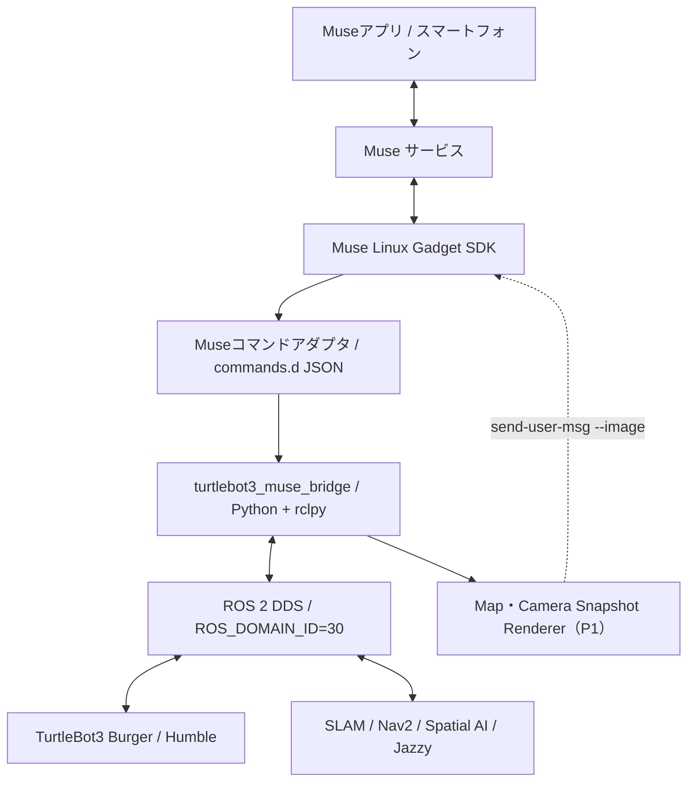

# TurtleBot3 Muse Gadget

TurtleBot3 Burger を **Muse 上で利用できるロボットガジェット** として接続するための、ROS 2 × Muse Gadget SDK 連携アプリケーションです。

別の Ubuntu マシン上の ROS 2 ノードからロボットの状態を読み取り、Muse アプリから自然言語で状態を照会したり、地図やカメラ画像のスナップショットを送信したりします。将来的には Nav2、Spatial Scene Graph、知識グラフとの連携を目指します。

> **ステータス：** `robot.status`、`robot.map`、常駐ブリッジを実装済みです。ROS 2 Jazzy 上での動作は確認しましたが、実機 TurtleBot3 と Muse アプリとの接続はまだ検証していません。詳細は [docs/basic_design.md](docs/basic_design.md) を参照してください。

## 位置づけ

このリポジトリは TurtleBot3 の bringup や Spatial AI の認識処理を複製しません。**Muse と ROS 2 を結ぶ境界（Gadget / Bridge）** だけを担当します。

| リポジトリ | 担当範囲 |
| --- | --- |
| [turtlebot3_spatial_ai](https://github.com/mutomasa/turtlebot3_spatial_ai) | SLAM、RGB-D 認識、Scene Graph、Neo4j、LLM、Nav2 |
| **turtlebot3-muse-gadget**（本リポジトリ） | Muse デバイス登録、ロボット状態取得、表示用画像生成、自然言語コマンド接続、通信監視、要求の安全検証 |

## アーキテクチャ



Muse から Ubuntu 上の登録コマンドを呼び出し、ローカルの Python 処理が ROS 2 DDS 経由で別ホストのロボットを観測します。初期実装では HTTP サーバーや ROS Bridge WebSocket を公開しません。

## システム環境

| 機器 | OS / ミドルウェア | 主な責務 |
| --- | --- | --- |
| TurtleBot3 Burger | Ubuntu 22.04 / ROS 2 Humble | Bringup、モーター、LiDAR、Odometry、TF |
| Ubuntu ワークステーション | Ubuntu 24.04 / ROS 2 Jazzy | RViz2、Muse Gadget SDK、ROS 2 Bridge |
| スマートフォン | Muse アプリ | BLE 初回ペアリング、チャット |

## ロードマップ

| フェーズ | 内容 |
| --- | --- |
| P0 | Ubuntu を Muse Gadget として登録し、`robot.status` で `/odom`・`/scan` の実データと接続状態を返す |
| P1 | `/map` の PNG 化と Muse への画像送信、カメラスナップショット、常駐ブリッジと状態キャッシュ |
| P2 | Scene Graph への読取専用問い合わせ、承認と検証を経た Nav2 移動指示 |
| P3 | RViz2 / Web 3D ビューアによるライブビュー |

タスクの詳細は [todo.md](todo.md) にまとめています。

## 実装状況

| コマンド | 状態 | 内容 |
| --- | --- | --- |
| `robot.status` | 実装済み・ROS 2 Jazzy 上で E2E 確認済み | `/odom`・`/scan`・`/battery_state` をワンショット購読し、状態 JSON を返す（読取専用） |
| `robot.map` | 実装済み・ROS 2 Jazzy 上で E2E 確認済み | `/map` を PNG 化し、`map → base_link` の TF でロボット位置を重畳して Muse チャットへ送信 |
| 常駐ブリッジ | 実装済み・ROS 2 Jazzy 上で E2E 確認済み | トピックを購読し続けて状態をキャッシュし、Unix ソケットで `robot.status` に返す（応答約 0.25 秒）。受信メトリクスも提供 |

Muse アプリとの接続（ペアリング、`send-user-msg` での実送信）と、実機 TurtleBot3 での確認はまだです。

## 構成

```text
src/turtlebot3_muse/
  config.py          設定（config/robot.toml）の読み込みと検証
  models.py          ROS 非依存のデータ型
  msg_convert.py     ROS メッセージ → データ型
  status_service.py  鮮度判定・状態分類・応答 JSON の生成
  ros_adapter.py     rclpy の購読（読取専用、/cmd_vel は発行しない）
  topic_monitor.py   最新サンプルと受信メトリクス（スレッド安全）
  ipc.py             Unix ソケット上の JSON 要求・応答
  bridge.py          常駐ブリッジ（status / metrics / ping）
  bridge_client.py   ブリッジへの問い合わせ（運用者向け）
  map_renderer.py    OccupancyGrid → PNG（2 MiB 以下に圧縮）
  muse_sender.py     musegadget send-user-msg の呼び出し
  status_cli.py      robot.status のエントリポイント
  map_cli.py         robot.map のエントリポイント
  mock_source.py     開発用モック（出力は必ず source: mock）
commands/            Muse の commands.d 定義
systemd/             常駐ブリッジの systemd ユニット
scripts/             ラッパー、インストーラー、ROS 2 疎通確認
config/robot.toml    トピック名・タイムアウト・鮮度閾値
```

応答 JSON の仕様は [docs/interfaces.md](docs/interfaces.md) にあります。

## 開発

```bash
uv sync
uv run pytest
```

ROS 2 なしでもモックで動作を確認できます。

```bash
uv run python -m turtlebot3_muse.status_cli --mock
uv run python -m turtlebot3_muse.map_cli --mock --out /tmp/turtlebot_map.png
```

リポジトリから直接ラッパーを実行すると、ROS 2 Jazzy 環境と `src/` を使います。

```bash
scripts/turtlebot-muse-status
scripts/turtlebot-muse-map --no-send --out /tmp/turtlebot_map.png
```

ラッパーは次の環境変数を既定値で設定します（環境変数または `/etc/turtlebot-muse/env` で上書き可能）。

| 変数 | 既定値 |
| --- | --- |
| `ROS_DOMAIN_ID` | `30` |
| `ROS_AUTOMATIC_DISCOVERY_RANGE` | `SUBNET` |
| `RMW_IMPLEMENTATION` | `rmw_fastrtps_cpp` |

## 導入手順

### 1. ROS 2 の受信確認

```bash
scripts/verify_ros2.sh
```

`/odom`・`/scan`・`/battery_state` の実メッセージ受信と、`odom → base_link` の TF を確認します。`topic list` に表示されるだけでは不十分です。

### 2. Muse Gadget SDK の導入

```bash
curl -fsSL https://raw.githubusercontent.com/facebookincubator/muse-gadget-sdk/main/linux/install.sh -o install.sh
less install.sh   # 内容を確認する
bash install.sh --run-as musebot --sdk-token 'YOUR_SDK_TOKEN'
```

- SDK トークンは [Muse Gadget SDK トークン画面](https://gadgets.muse.ai/settings/sdk-tokens) で取得します。**GitHub にコミットしないでください。**
- `musebot` などの専用ユーザーで動かし、sudo 権限は与えません。

### 3. コマンドとブリッジの登録

```bash
sudo apt install python3-pil      # robot.map 用
sudo scripts/install.sh --with-bridge --restart
sudo -u musebot /usr/local/bin/turtlebot-muse-status
sudo -u musebot /usr/local/bin/turtlebot-muse-bridge-ctl metrics
```

`--with-bridge` を付けると常駐ブリッジ（`turtlebot3-muse-bridge.service`）も導入します。ブリッジがなくても `robot.status` はワンショット購読で動きます。詳しくは [docs/setup.md](docs/setup.md) を参照してください。

インストール先は次のとおりです。

| 内容 | 場所 |
| --- | --- |
| Python パッケージ・ラッパー | `/opt/turtlebot-muse/` |
| コマンド（シンボリックリンク） | `/usr/local/bin/turtlebot-muse-{status,map,bridge,bridge-ctl}` |
| 常駐ブリッジ | `/etc/systemd/system/turtlebot3-muse-bridge.service`、ソケット `/run/turtlebot-muse/bridge.sock` |
| Muse コマンド定義 | `/etc/musegadget/commands.d/robot.{status,map}.json` |
| 設定 | `/etc/turtlebot-muse/robot.toml`（既存なら上書きしない） |

Muse アプリでは「`robot.status` を使って TurtleBot3 Burger の位置、向き、LiDAR の状態を教えて」「`robot.map` で地図を送って」のように指示します。

### 応答例（例示値）

```json
{
  "robot": "TurtleBot3 Burger",
  "source": "ros2_live",
  "state": "online",
  "observed_at": "2026-11-10T00:00:00Z",
  "odom": { "received": true, "frame_id": "odom", "x_m": 1.23, "y_m": 0.45, "yaw_deg": 90.0, "fresh": true },
  "lidar": { "received": true, "frame_id": "base_scan", "min_distance_m": 0.82, "valid_points": 380, "total_points": 400, "fresh": true },
  "battery": { "received": true, "voltage_v": 11.9, "fresh": true },
  "warnings": []
}
```

`state` は `online` / `degraded` / `offline` / `unknown` のいずれかです。ROS 2 通信に失敗したときにサンプル値を返すことはありません。開発用モックは必ず `source: mock` を明示します。

## 安全性の方針

- P0 のコマンドは**読取専用**で、ロボットを動かしません。
- 移動は Nav2 Action を経由させ、LLM から `/cmd_vel` を直接発行しません。移動要求はユーザーの明示的な承認と検証を通過した場合に限ります。
- Muse SDK は非 sudo の専用ユーザーで動かします。
- 地図やカメラ画像には人や私物が写る可能性があるため、送信前に内容を確認します。

## ドキュメント

- [基本設計書](docs/basic_design.md)
- [セットアップ手順](docs/setup.md)
- [インターフェース仕様](docs/interfaces.md)
- [トラブルシューティング](docs/troubleshooting.md)
- [セキュリティと安全性](docs/security.md)
- [タスク一覧](todo.md)

## 参考資料

- [Meta Muse Gadget SDK](https://github.com/facebookincubator/muse-gadget-sdk)
- [TurtleBot3 公式ドキュメント](https://emanual.robotis.com/docs/en/platform/turtlebot3/overview/)
- [ROS 2 Documentation](https://docs.ros.org/)
- [Nav2 Documentation](https://docs.nav2.org/)

## ライセンス

[MIT](LICENSE)
