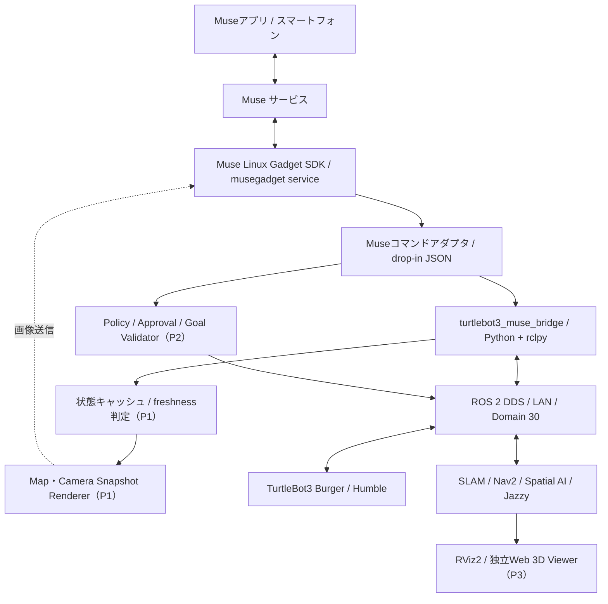
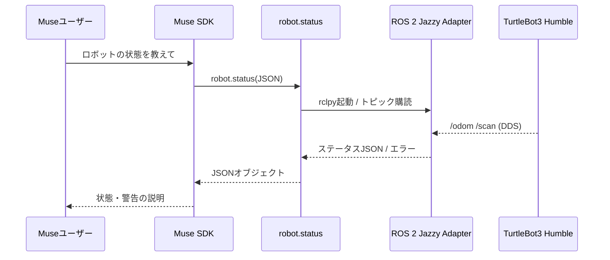

# TurtleBot3 Muse Gadget — 設計書

| 項目 | 内容 |
| --- | --- |
| 推奨リポジトリ名 | `turtlebot3-muse-gadget` |
| 推奨GitHub URL | `https://github.com/mutomasa/turtlebot3-muse-gadget`（新規作成予定。未作成） |
| プロジェクト種別 | 独立したROS 2 × Muse Gadget SDK連携アプリケーション |
| 対象ロボット | TurtleBot3 Burger |
| 作成日 | 2026-11-10 |
| ステータス | 設計案。実機・Muse接続の総合検証は未実施 |
| 参考プロジェクト | [mutomasa/turtlebot3_spatial_ai](https://github.com/mutomasa/turtlebot3_spatial_ai) |

## 0. プロジェクトの目的と位置づけ

TurtleBot3 Burgerを **Muse上で利用できるロボットガジェット** として接続する。別のUbuntuマシン上のROS 2ノードからロボットの状態を読み取り、Museアプリから自然言語で状態照会し、地図やカメラ画像のスナップショットを送信する。将来的にはNav2、Spatial Scene Graph、知識グラフと連携する。

`TurtleBot3`のbringupや`Spatial AI`の認識処理をこのリポジトリに複製するのではなく、**MuseとROS 2を結ぶ境界（Gadget / Bridge）** を専用コンポーネントとして開発する。

### 0.1 既存プロジェクトとの役割分担

- **`turtlebot3_spatial_ai`**：SLAM、RGB-D認識、Scene Graph、Neo4j、LLM、Nav2の研究・実装を担当する。
- **`turtlebot3-muse-gadget`（本リポジトリ）**：Museデバイス登録、ロボット状態取得、表示用画像生成、自然言語コマンド接続、通信監視と安全な要求検証を担当する。
- 連携にはROS 2の標準トピック／Actionと、必要に応じて既存プロジェクト側の読取専用APIを用いる。既存リポジトリは変更しなくてもP0を開始できる。

### 0.2 「Museにロボットを表示する」の定義

**区別すべき3段階：**

1. **Museのデバイスとして認識**：Linux Device SDKにより、Ubuntuホストが`MuseGadgetXXXXXX`としてMuseに登録される。これはロボットの3Dモデルの表示とは異なる。
2. **Museチャットでロボットの情報を表示**：位置、向き、LiDAR状態、地図・カメラ画像などを文章やスナップショットとして返す。P0〜P1の対象。
3. **ロボットの3Dライブビューを表示**：Museアプリ内の任意3Dウィジェット描画APIは公開Linux SDKから確認できない。P3ではRViz2または独立Web 3Dビューアを利用し、Museからその情報にアクセスする構成を採る。Muse内への独自3Dビュー埋め込みは追加のSDK調査が必要で、実装可能と断定しない。

## 1. システム環境

既存リポジトリのREADME（2026-11-09時点）に基づく。

| 機器 | OS / ミドルウェア | 主な責務 |
| --- | --- | --- |
| TurtleBot3 Burger | Ubuntu 22.04系 / ROS 2 Humble | Bringup、モーター、LiDAR、Odometry、TF。実機側でテレオペ可 |
| Ubuntuワークステーション | Ubuntu 24.04 / ROS 2 Jazzy | RViz2、Muse Gadget SDK、ROS 2 Bridge、将来のSLAM/Nav2/Spatial AI |
| Mac | macOS | SSH、リモートデスクトップ、開発 |
| Museアプリ搭載スマートフォン | 対応するMuseアプリ | Bluetooth LE初回ペアリング、ガジェット利用・チャット |

**ネットワーク前提：**

- TurtleBot3とワークステーションはROS 2 DDSで通信する。同じLAN、`ROS_DOMAIN_ID=30`で既にデータ送受信できることを事前確認する。
- Humble／Jazzyの異なるROS 2ディストリビューション間通信は、各トピックの実データ受信・QoS・DDS実装・ネットワークで検証する。「topic listに出た」だけでは正常とみなさない。
- Muse Gadget SDKはワークステーション上に配置し、TurtleBot3のRaspberry Piへ必須追加しない。
- Museの初回ペアリングにはGadgetを実行するホスト側のBluetooth LEが必要。ワークステーションにBLEがなければ、BLE付きの別Linux機（例：Raspberry Pi）をMuseホストとし、Ubuntu ROS 2 PCには認証済みの狭い読取専用APIを設ける代替構成とする。

### 1.1 ROS 2トピックとデータ元

| トピック / API | メッセージ型 | 役割 | フェーズ |
| --- | --- | --- | --- |
| `/odom` | `nav_msgs/msg/Odometry` | 位置・姿勢・速度 | P0 |
| `/scan` | `sensor_msgs/msg/LaserScan` | LiDAR接続と距離情報 | P0 |
| `/tf`, `/tf_static` | `tf2_msgs/msg/TFMessage` | `odom`/`map`と`base_link`の座標変換 | P1 |
| `/map` | `nav_msgs/msg/OccupancyGrid` | SLAMの2D地図 | P1 |
| `/camera/color/image_raw` 等 | `sensor_msgs/msg/Image` または圧縮画像 | カメラスナップショット | P1 |
| `NavigateToPose` Action | `nav2_msgs/action/NavigateToPose` | 明示的承認後の移動要求 | P2 |
| Scene Graphの読取API | 既存実装に応じて定義 | 物体・空間関係の問い合わせ | P2 |

> `/odom`の座標は通常`odom`フレーム基準であり、SLAM地図上の`map`座標と同一視しない。地図上へ表示する場合は`map → base_link`のTFを利用する。実際のトピック名・QoS・カメラの有無は機器で確認する。

## 2. システムアーキテクチャ



**接続方式：** MuseからUbuntu上の登録コマンドを呼び出し、ローカルのPython処理がROS 2 DDSで別ホストのロボットを観測する。初期実装では独自HTTPサーバーやROS Bridge WebSocketを公開する必要はない。

### 2.1 実行プロセス

1. **Muse Device Service**：公式Linux SDKが持つ接続・認証・ペアリング・コマンド受付を利用。独自にMuseの暗号化プロトコルを再実装しない。
2. **Muse Command Adapter**：`/etc/musegadget/commands.d/*.json`から独自コマンドを宣言し、`/usr/local/bin/...`のラッパーを起動。パラメータは標準入力のJSON、結果は標準出力のJSONオブジェクトで返す。
3. **ROS 2 Adapter**：`rclpy`で購読／TF照会。P0はワンショット処理、P1では長時間常駐とキャッシュを検討する。
4. **Renderer**：OccupancyGridから2D地図PNGを生成。必要ならTFのロボット位置・向きを重畳する。
5. **Safe Action Adapter（将来）**：移動はNav2 Actionを通し、LLMが直接`/cmd_vel`を発行しない。

## 3. 実装スコープと優先順位

| 優先度 | 機能 | 完了条件 |
| --- | --- | --- |
| P0 | MuseにUbuntuをGadgetとして登録 | MuseアプリからGadgetを認識し接続できる |
| P0 | `robot.status` | `/odom`、`/scan`の新鮮な実データと接続状態を返す |
| P0 | 通信エラー・タイムアウト処理 | 未受信時に「未接続／不明」を返し、正常と誤判定しない |
| P0 | ROS 2 Humble ↔ Jazzy検証 | ワークステーションから両トピックを受信できる |
| P1 | `robot.map_snapshot`相当 | `/map`をPNG保存し、Museに画像送信できる |
| P1 | カメラ画像取得 | 実機の画像トピックからJPEG等を送信できる |
| P1 | 監視ノード・状態キャッシュ | タイムスタンプ付き状態、鮮度判定、メトリクスを管理できる |
| P2 | Scene Graph問い合わせ | 空間関係を自然言語応答へ反映できる |
| P2 | Nav2移動指示 | 承認・到達可能性・安全検証を通過した場合だけActionを発行する |
| P3 | 独立3Dビューア | ロボットモデル・地図・経路・Scene GraphをWebで描画する |

**MVPでは実装しない：** Museアプリ内のネイティブ3D拡張UI、連続動画配信、任意シェル実行機能の追加、LLMからの直接的な速度制御、地図やScene Graphの新規生成ロジック。

## 4. Muse Gadget SDKとのインターフェース

### 4.1 SDKの採用理由と確認済み仕様

公式Linux SDKは以下を提供する。

- Linux機をMuse Gadgetとしてペアリング・登録する。Ubuntu 22.04以降が対象。
- `system.run`、`file.read`、`file.write`、`device.health`などの標準コマンド。
- `commands.d`にJSONファイルを配置する独自コマンド拡張。
- `musegadget send-user-msg`によるMuseチャットへの送信と、`--image`による画像添付。PNG/JPEG/GIF/WebP、1画像最大2 MiB。
- Python SDKの`Service`、`LinkSession`、`send_chat`、`send_image`等の拡張ポイント。

**注意：** `send-user-msg --image`はMuseチャットへの画像投稿であり、Muse側に常時表示される専用ウィジェットの追加ではない。画像を作成しただけではMuseへ送信されないため、画像生成と画像送信を別ステップとして扱う。

### 4.2 `robot.status`コマンド定義例

配置先：`/etc/musegadget/commands.d/robot.status.json`

```json
{
  "description": "Read the latest TurtleBot3 Burger ROS 2 odometry and LiDAR status without moving the robot.",
  "exec": ["/usr/local/bin/turtlebot-muse-status"],
  "required": {},
  "optional": {},
  "timeout_ms": 10000
}
```

Muse SDKはこのJSONの`exec`をシェル経由ではなく直接実行する。ラッパーが`source /opt/ros/jazzy/setup.bash`と`ROS_DOMAIN_ID=30`の設定を行う。ROS 2モジュールを使用するPythonはワークステーションのROS 2環境と互換性のある `/usr/bin/python3` を原則とする。`uv`仮想環境などでROS 2のPythonライブラリを見失わないようにする。

ラッパー例：

```bash
#!/usr/bin/env bash
set -euo pipefail
source /opt/ros/jazzy/setup.bash
export ROS_DOMAIN_ID=30
exec /usr/bin/python3 /opt/turtlebot-muse/robot_status.py
```

**Museでの指示例：** 「`robot.status`を使ってTurtleBot3 Burgerの位置、向き、LiDARの状態を教えて」。

### 4.3 ステータスの応答スキーマ

データ源、座標系、観測時刻、新鮮さを明記する。以下は**例示値（実機観測値ではない）**。

```json
{
  "robot": "TurtleBot3 Burger",
  "source": "ros2_live",
  "state": "online",
  "observed_at": "2026-11-10T00:00:00Z",
  "odom": {
    "received": true,
    "frame_id": "odom",
    "x_m": 1.23,
    "y_m": 0.45,
    "yaw_deg": 90.0,
    "fresh": true
  },
  "lidar": {
    "received": true,
    "frame_id": "base_scan",
    "min_distance_m": 0.82,
    "fresh": true
  },
  "warnings": []
}
```

- `state`は`online`、`degraded`、`offline`、`unknown`から選ぶ。オンライン判定は必須トピックの受信と鮮度条件を満たす場合に限定する。
- メッセージのヘッダ時刻と受信単調時計の両方を考慮する。時刻同期が不明な場合は受信後の経過時間を基準にする。
- P0はワンショット購読で最大4秒待機、SDKコマンドのタイムアウト10秒を初期値とする。P1でサービス化する際は定常監視と短時間キャッシュへ変更可能。
- `/scan`の最短距離は`range_min <= r <= range_max`かつ有限の値に限定する。すべて不正値なら`null`とする。
- `/odom`の姿勢は四元数からyaw角に変換する。地図上の絶対位置であるとは主張しない。
- ROS 2通信に失敗した場合にサンプル数値を返してはいけない。開発用モックは必ず`source: mock`と明記する。
- JSONからユーザーの自然言語回答を生成するときも、欠測・古い値を事実として表示しない。

### 4.4 地図・カメラスナップショット

**2D地図：** `/map`（OccupancyGrid）を購読し、unknown/free/occupiedを識別して画像化する。`map → base_link`のTFが取得できた場合は現在位置と向きを重畳する。欠落時は位置マーカーなしの画像と明示的警告を出す。回転したマップ原点・解像度・上下反転・地図サイズを考慮する。

**画像送信：**

```bash
# /mapが存在する場合。ROS 2環境を読み込んだ端末で実行する。
python3 scripts/robot_map_snapshot.py --out /tmp/turtlebot_map.png
musegadget send-user-msg --image /tmp/turtlebot_map.png "TurtleBot3の地図です。位置を確認してください。"
```

`send-user-msg`はペアリング済みSDKとローカルソケットにアクセスできるユーザー権限で実行する。MVPでは手動送信を先に確認し、P1では認可済み要求のみを非同期キューで送信する。画像は2 MiB以下に縮小／再圧縮する。

**カメラ：** 現物で`/camera/...`を確認してから実装する。カメラが接続されていない場合は機能を「未設定」と表示する。

### 4.5 Scene Graph問い合わせ（P2）

- `robot.scene_query`等の専用コマンドを定義する。
- 例：「観葉植物の近くにある椅子はどこ？」「ロボットから一番近い机を教えて」。
- `turtlebot3_spatial_ai`側のGraph APIまたは許可済みNeo4j読取クエリを呼ぶ。任意のCypher文字列をMuseから直接実行させない。
- 回答には物体ID・空間関係・推定座標系・最終観測時刻・信頼度を含める。
- Scene Graphは外部コンポーネントであり、このリポジトリはスキーマを勝手に変更しない。APIの契約テストを作る。

## 5. ROS 2設計

### 5.1 P0：ワンショットステータス取得



- `qos_profile_sensor_data`を`/scan`の初期候補とする。`/odom`は実際のpublisherに対応するQoSを選ぶ。互換性のない場合はトピックのQoS診断を行う。
- 切断やデータ欠落を分類する（`timeout`、`no_scan`、`no_odom`、`stale`など）。
- ROS 2のコンテキストを`finally`で終了し、Museコマンドをブロックし続けない。

### 5.2 P1：常駐ブリッジ

問い合わせ頻度が増えたら、`rclpy`ノードを常駐させてキャッシュを更新し、Muse側の短いコマンドからローカルIPC（Unix domain socket等）で読み込む。HTTP公開は初期段階では不要。購読と画像化を分離し、Muse接続が切れてもROS 2監視処理は回復できるようにする。

監視項目：受信メッセージ数、最後の受信時刻、センサーデータ鮮度、TF変換成功率、SDK再接続回数、コマンド失敗率、スナップショット生成時間。

### 5.3 P2：移動制御の安全境界

- Museからの自然言語はまず**要求の提案**として解釈し、ユーザーの明示承認後に実行する。
- `PoseStamped`の`frame_id`、座標値、到達可能性、禁止領域、衝突余裕、位置・地図鮮度を検証する。
- 経路計画と障害物回避はNav2に委譲し、直接`/cmd_vel`を発行しない。
- 実行権限は読取専用機能と分け、タイムアウト、取消し、通信断時の動作を定義する。
- 実機の物理的な緊急停止手段を確保する。`/cmd_vel`にゼロを送るだけで緊急停止と同等にはならない。

## 6. 推奨リポジトリ構成

```text
turtlebot3-muse-gadget/
├── README.md
├── design.md
├── LICENSE
├── .gitignore
├── pyproject.toml
├── config/
│   └── robot.yaml                 # ROS_DOMAIN_ID、トピック、鮮度閾値など
├── commands/
│   ├── robot.status.json         # P0 Museコマンド
│   ├── robot.map.json            # P1 設計・追加予定
│   └── robot.scene_query.json    # P2 設計・追加予定
├── src/
│   └── turtlebot3_muse/
│       ├── __init__.py
│       ├── ros_adapter.py        # rclpy購読、TF
│       ├── status_service.py     # 状態・鮮度判定
│       ├── muse_commands.py      # Muse向けJSON入出力
│       ├── map_renderer.py       # P1 OccupancyGrid → PNG
│       ├── camera_snapshot.py    # P1 画像取得・圧縮
│       ├── scene_graph_client.py # P2 外部Graph API
│       ├── nav2_client.py        # P2 Goal Validator経由
│       └── models.py             # 型定義と検証
├── scripts/
│   ├── install.sh
│   ├── verify_ros2.sh
│   ├── turtlebot-muse-status
│   ├── robot_status.py           # 既存starterのワンショット実装を移植可
│   └── robot_map_snapshot.py    # 既存starterの地図生成を移植可
├── systemd/
│   └── turtlebot3-muse-bridge.service  # P1以降
├── docs/
│   ├── setup.md
│   ├── troubleshooting.md
│   ├── security.md
│   └── interfaces.md
└── tests/
    ├── test_status.py
    ├── test_qos_and_timeout.py
    ├── test_muse_commands.py
    ├── test_map_renderer.py
    └── fixtures/
        ├── odom.json
        └── scan.json
```

MVPは`commands/robot.status.json`、`scripts/turtlebot-muse-status`、`scripts/robot_status.py`の小さな実装から開始できる。前回作成したスターターキットの内容を新リポジトリへ移植し、テストを追加する。`src/`以下は設計上の将来構成であり、すべて実装済みという意味ではない。

## 7. 導入・動作確認

### 7.1 ROS 2の接続確認（Ubuntuワークステーション）

```bash
source /opt/ros/jazzy/setup.bash
export ROS_DOMAIN_ID=30

ros2 topic list
ros2 topic info /odom -v
ros2 topic info /scan -v
ros2 topic echo /odom --once
ros2 topic echo /scan --once
ros2 run tf2_ros tf2_echo odom base_link
```

`/scan`が出ない場合はLiDAR電源・ドライバ・QoS・DDS到達性を調査し、故障を正常と誤認しない。地図表示には別途SLAMまたはMap Serverが必要。

### 7.2 Muse Gadget SDKの導入

1. [Muse Gadget SDKトークン画面](https://gadgets.muse.ai/settings/sdk-tokens)でトークンを取得する（トークンをGitHubにcommitしない）。
2. SDKの[Linuxインストーラー](https://github.com/facebookincubator/muse-gadget-sdk/blob/main/linux/install.sh)をダウンロードし、内容を確認する。
3. `musebot`などの専用非sudo OSユーザーを用意し、そのユーザー権限でGadgetサービスが動作するようにする。
4. MuseアプリのSettings → Devices → Developer modeを有効にし、`MuseGadgetXXXXXX`をペアリングする。
5. `musegadget doctor`、`systemctl status musegadget`、`journalctl -u musegadget`で状態を確認する。

```bash
curl -fsSL https://raw.githubusercontent.com/facebookincubator/muse-gadget-sdk/main/linux/install.sh -o install.sh
less install.sh
bash install.sh --run-as musebot --sdk-token 'YOUR_SDK_TOKEN'
```

> 公式SDKはインストール対象のOSアカウントに対するシェル・ファイル操作も提供する。`musebot`にsudoを与えない。利用規約、ペアリング時のセキュリティ警告、公開ネットワーク経由での利用を確認すること。

### 7.3 Museコマンド登録

```bash
sudo install -d -m 755 /opt/turtlebot-muse /etc/musegadget/commands.d
sudo install -m 644 scripts/robot_status.py /opt/turtlebot-muse/robot_status.py
sudo install -m 755 scripts/turtlebot-muse-status /usr/local/bin/turtlebot-muse-status
sudo install -m 644 commands/robot.status.json /etc/musegadget/commands.d/robot.status.json
sudo systemctl restart musegadget
sudo journalctl -u musegadget -n 50 --no-pager
```

Gadgetの実行ユーザーと同じ権限で`/usr/local/bin/turtlebot-muse-status`をテストし、JSONとしてパースできること、標準出力に余分なログが混ざらないことを確認する。

### 7.4 画像送信（P1）

```bash
sudo apt install python3-pil
source /opt/ros/jazzy/setup.bash
export ROS_DOMAIN_ID=30
python3 scripts/robot_map_snapshot.py --out /tmp/turtlebot_map.png
musegadget send-user-msg --image /tmp/turtlebot_map.png "TurtleBot3の2D地図です"
```

上記は地図が存在し、Museのローカルソケットへアクセスできるユーザーで実行した場合のフロー例。

## 8. セキュリティ・安全性

- **最小権限：** Muse SDKを通常の開発・管理者アカウントで動かさない。root/sudo権限を付与せず、ROS 2参照に必要な権限のみに制限する。
- **ROS 2トピックと制御権限：** P0の独自コマンドは購読専用。DDS自体の信頼境界が弱い場合、GadgetをROS 2ネットワークに直接置くことのリスクを明示する。将来は読取専用APIゲートウェイやネットワーク分離を検討。
- **接続保護：** SDKトークンやセッション情報をログ・GitHubに置かない。ペアリングは信頼できるネットワークで実施する。リモートブリッジのポートをインターネットに公開しない。
- **実機制御：** Nav2移動要求は別権限、確認と検証後にのみ許可。速度・地理的制約・障害物・停止手段・切断時のふるまいをテスト。
- **プライバシー：** 地図・カメラ画像には私物や人が映り得る。Muse送信の前に内容・送信先・記録方針を確認する。
- **可観測性：** 操作の要求時刻、結果、拒否理由、例外分類を記録。ただし秘密情報や画像データを不要に残さない。

## 9. テスト計画と受入基準

### 9.1 単体テスト

| テスト | 観点 | 期待結果 |
| --- | --- | --- |
| JSON契約 | `robot.status`の入出力 | パース可能、必須属性あり、標準出力はJSONのみ |
| オドメトリ処理 | 四元数→yaw、frame_id | 角度と座標系が正しい |
| LiDAR処理 | `NaN`、`Inf`、範囲外 | 有効値のみ集計。無効のみなら`null` |
| 接続断 | `/odom`、`/scan`未着 | `offline`/`unknown`等と警告を返す |
| 片系欠落 | `/scan`のみ未着 | `degraded`等で欠落を明示 |
| タイムアウト | ROS 2購読の待機上限 | Museコマンドが無制限に待機しない |
| 地図生成 | 占有値・回転・TF欠落 | 表示が正しく、位置不明を明示 |
| モック | 実機なしのCI | `source=mock`で本番と区別する |

### 9.2 結合・実機テスト

1. UbuntuワークステーションのJazzyから、Burger（Humble）の`/odom`、`/scan`の**実メッセージ**が取得できる。
2. MuseからGadgetが認識でき、`robot.status`を呼び出せる。
3. 正常時に位置、向き、LiDAR状態が表示され、フレーム情報が誤解なく伝わる。
4. LiDAR停止・ネットワーク断のテストで、古いデータを現在値として返さない。
5. `/map`がある場合にPNGを生成し、Museチャットで画像を確認できる。
6. `/map`がない場合には明確なエラーを返し、擬似地図を生成しない。
7. Gadgetサービス再起動後にMuseとの接続が再確立し、独自コマンドが登録される。
8. read-onlyのP0実行中にロボットへの移動コマンドを発行しない。

### 9.3 非機能要件（初期目標）

- `robot.status`：最大10秒で成功・失敗が判定できること。
- Muse切断やROS 2停止時にコマンド／監視ノードが無限待機しないこと。
- 画像は最大2 MiBに収め、エラー時は画像生成の有無を明示すること。
- サービスログからSDK接続、コマンド受付、ROS 2データ欠落を切り分けられること。

## 10. 実装ステップ / タスクバックログ

### Phase 0：接続基盤（最優先）

- [ ] 新規リポジトリ`mutomasa/turtlebot3-muse-gadget`を作成し、`design.md`とREADMEを配置
- [ ] ROS 2 Humble ↔ Jazzyの通信、`ROS_DOMAIN_ID=30`、QoSを確認
- [ ] ワークステーションのBLE有無を確認
- [ ] Muse SDKを非sudo専用ユーザーで導入・ペアリング
- [ ] `robot.status`のコマンド定義とCLIを移植・単体テスト
- [ ] Museの自然言語指示から状態確認できることを実機検証

### Phase 1：可視化と監視

- [ ] `/map`の受信、2D PNG生成とMuse画像送信
- [ ] `/tf`利用による地図上のロボットマーカー表示
- [ ] カメラ画像トピックを調査し、必要な場合のみ静止画取得
- [ ] 長時間常駐Bridge、鮮度判定・ローカルIPC・メトリクス導入

### Phase 2：ロボットアプリケーションのガジェット

- [ ] Scene Graphの読取専用クエリとの接続
- [ ] Nav2のゴール候補表示、確認フローと安全制御
- [ ] 行動結果と状態遷移のMuseへの通知

### Phase 3：拡張ビュー

- [ ] RViz2やThree.js/WebXRでロボットのライブビューを構築
- [ ] Muse側との連携方式（URL共有・画像通知・API連携）を整理
- [ ] Muse公式SDKに独自UI機構が追加された場合のみネイティブ埋め込みを再評価

## 11. 懸念点と判断基準

| 懸念 | 確認方法 / 対応 |
| --- | --- |
| Muse SDKで3D UIを埋め込めるか | 現状は保証しない。別Webビューアを採用し、公式SDKの更新時に再評価 |
| UbuntuホストにBLEがない | BLE付きLinuxガジェットホストへの分離を検討 |
| Humble/Jazzyの通信が不安定 | QoS、RMW、DDS Discovery、ファイアウォール、同一ドメインの実通信を調査 |
| LiDARの`/scan`が未出力 | bringup、電源、ドライバ確認。未受信をそのままMuseに報告 |
| `/map`がまだない | 地図機能は保留し、P0の状態取得だけで成立させる |
| 生成した画像がMuseに見えない | 画像生成と`send-user-msg --image`を別個に診断 |
| ガジェット経由の実機制御が危険 | P0は読取専用。P2はAction・検証・承認・物理E-stopを必須 |

## 12. 参考資料

1. [Meta Muse Gadget SDK（GitHub）](https://github.com/facebookincubator/muse-gadget-sdk)
2. [Muse Linux Device SDK README](https://github.com/facebookincubator/muse-gadget-sdk/blob/main/linux/README.md)
3. [Muse独自コマンド実装（commands.py）](https://github.com/facebookincubator/muse-gadget-sdk/blob/main/linux/src/musegadget/commands.py)
4. [Muse SDKトークン](https://gadgets.muse.ai/settings/sdk-tokens)
5. [TurtleBot3 Spatial AI（既存リポジトリ）](https://github.com/mutomasa/turtlebot3_spatial_ai)
6. [TurtleBot3公式ドキュメント](https://emanual.robotis.com/docs/en/platform/turtlebot3/overview/)
7. [ROS 2 Documentation](https://docs.ros.org/)
8. [Nav2 Documentation](https://docs.nav2.org/)

---

**最初の成果物：** Museから`robot.status`を呼び出し、別のUbuntuマシンでROS 2を動作させているTurtleBot3 Burgerの実際の`/odom`と`/scan`を読み取り、現在状態として説明できること。次に2D地図の画像送信を追加する。
